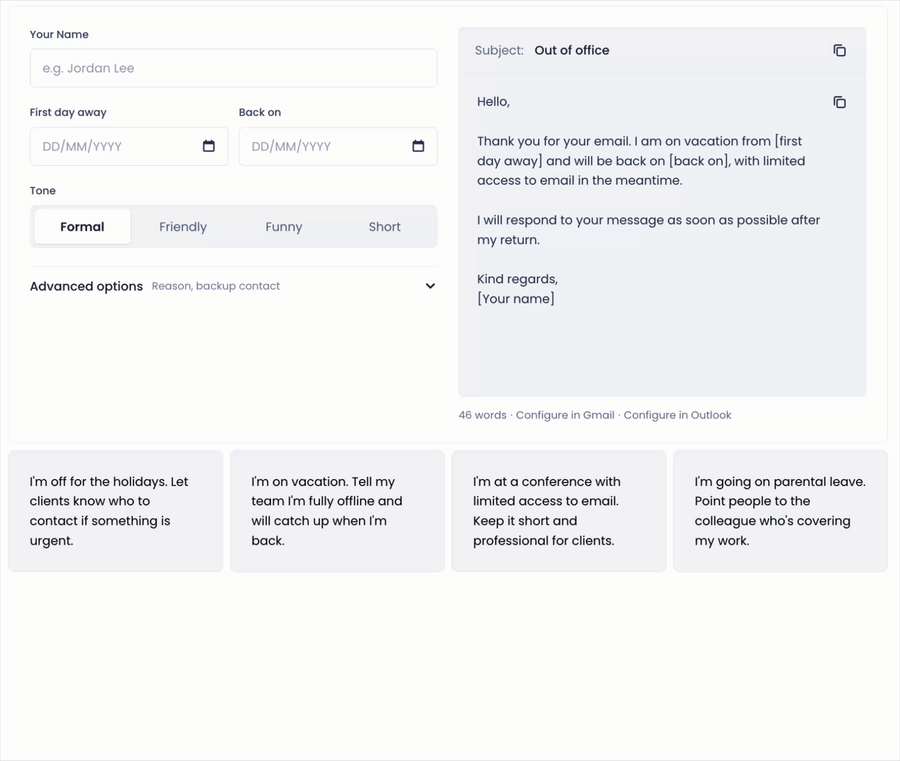
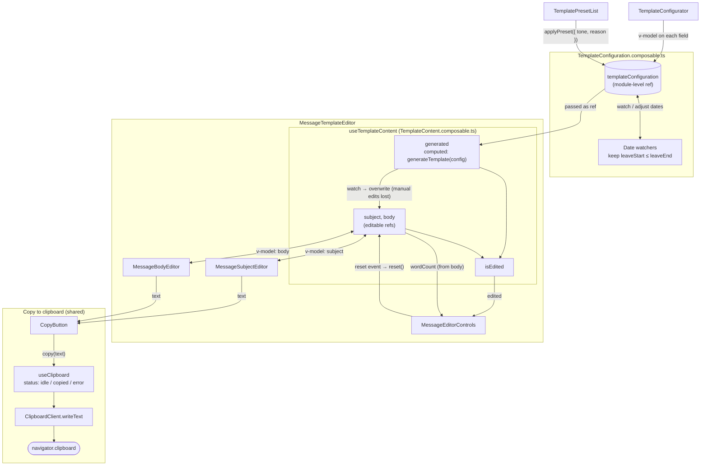

# Handover

This document contains handover information for the people receiving the project.

## Mailmeteor out of office tool

This is a mailmeteor tool that helps you write Out of office emails based on a set of predefined templates.

## Demo



## Getting started

When starting on this project please refer to the [README.md](README.md) file, which contains instructions on how to setup and start working on this project.

## Architecture

### Folder structure

The code is organised by feature. Code that belongs to one feature lives in that feature's folder. Only generic, reusable code goes in `shared/`.

```
src/
├── main.ts                  # App bootstrap, imports global styles
├── App.vue                  # Root component, renders the feature page
├── assets/icons/            # SVG icons, imported as Vue components via `?component`
├── styles/global.css        # Global styles and design tokens (CSS custom properties)
├── features/
│   └── email-templating/    # The only feature today: building the out of office message
│       ├── pages/           # EmailTemplate.page.vue, the top-level page
│       ├── components/      # Configurator, selectors, preset list and message editors
│       ├── composables/     # Shared configuration state and generated subject/body
│       └── models/          # Types: Tone, Reason, TemplateConfiguration, TemplatePreset
└── shared/
    ├── components/
    │   ├── buttons/         # CopyButton, PillButton
    │   ├── forms/           # TextInput, EmailInput, DateInput, InputLabel
    │   └── layout/          # Panel, CollapsibleSection, SwitchBar
    ├── composables/         # useClipboard (copy feedback), useDate (date parsing and formatting)
    └── infrastructure/      # ClipboardClient, the only code that touches the browser clipboard
e2e/                         # Playwright specs, one per user flow
└── support/page.ts          # Shared page helpers for the E2E specs
```

Rules to keep the structure consistent:

- `src/shared/` must never import from `src/features/`.
- New features get their own kebab-case folder under `src/features/`, with only the subfolders they need.
- Unit tests sit next to the file they test, named `<File>.spec.ts`.

The full conventions, including import rules, are in [CLAUDE.md](CLAUDE.md).

### File conventions

Each kind of file has one job. Code calls downwards only: pages and components → composables → infrastructure → outside world. Models can be used anywhere.

- **Page** (`pages/<Name>.page.vue`): The top-level view of a feature, rendered by `App.vue`. A page lays out the feature's components and holds little or no logic of its own. Pages are also mean to be registered with an application router.

- **Component** (`components/<Name>.vue`): A reusable piece of UI. It gets data through props and composables and reports user actions through events. It never calls infrastructure or browser APIs directly. Feature components such as [ToneSelector.vue](src/features/email-templating/components/ToneSelector.vue) can use that feature's models and composables. Shared components such as [TextInput.vue](src/shared/components/forms/TextInput.vue) know nothing about any feature.

- **Composable** (`composables/<Name>.composable.ts`): State and logic, exported as a `use<Name>` function. Components call composables, and composables call infrastructure whenever they need something outside the app.

- **Model** (`models/<Name>.model.ts`): TypeScript types and interfaces, one main type per file, with no runtime behaviour. Example: [Tone.model.ts](src/features/email-templating/models/Tone.model.ts).

- **Infrastructure** (`infrastructure/<Name>.ts`): The only code that leaves the app, such as HTTP calls, `localStorage` or browser services like `navigator.clipboard`. A file is named after what it does, such as a client, service, store or configuration, and exposes small, typed functions with no Vue reactivity or UI logic.

## Content and domain

### Overview

The app has a single page, [App.vue](src/App.vue) renders [EmailTemplate.page.vue](src/features/email-templating/pages/EmailTemplate.page.vue), which lays out three parts:

- [TemplateConfigurator.vue](src/features/email-templating/components/TemplateConfigurator.vue) (left column): the form. It has the user's name, the first day away, the return date and the tone. The reason and the backup contact (name and email) sit under "Advanced options".
- [MessageTemplateEditor.vue](src/features/email-templating/components/MessageTemplateEditor.vue) (right column): the generated subject and body. Both can be edited and copied. Below them, [MessageEditorControls.vue](src/features/email-templating/components/MessageEditorControls.vue) shows a word count, a "Reset" button and the Gmail/Outlook links.
- [TemplatePresetList.vue](src/features/email-templating/components/TemplatePresetList.vue) (below the panel): preset cards. Clicking one sets the tone and the reason in one go.

The page holds no state of its own. Each component gets what it needs from the composables described below.

### Data flow



- The configurator form binds each field straight to the shared templateConfiguration state declared in [TemplateConfiguration.composable.ts](src/features/email-templating/composables/TemplateConfiguration.composable.ts). This configuration state is used to build up the template and update the template when it changes.
- The `MessageTemplateEditor` passes the `templateConfiguration` ref to `useTemplateContent` which computes the template and copies it into the editable `subject` and `body` refs.
- The preset panels apply partial template configurations by calling the `applyConfiguration` function.
- In the case where the user has edited the generated template, any change to the configuration will reset the template to the non edited version.

### How templates are built

Messages are generated in [TemplateContent.composable.ts](src/features/email-templating/composables/TemplateContent.composable.ts) in two steps:

1. **`toTemplateValues(config)`** turns the raw configuration into strings that are ready to insert:

2. Calling **`BASE_TEMPLATES[tone](values)`** returns `{ subject, body }` which are used to display the template text directly. `BASE_TEMPLATES` has one function per tone (`formal`, `friendly`, `funny`, `short`), written as template literals.

## UI and styling

### Design tokens

All design tokens are CSS custom properties on `:root` in [global.css](src/styles/global.css). It is the only global stylesheet and is imported once in [main.ts](src/main.ts). Every component uses `<style scoped>` and reads its values from these tokens.

When to add a token:

- Colors, font sizes, font weights, radii, spacing and shadows always come from a token. No component has a hard-coded color today, so keep it that way.
- If no existing token fits, add one to the right group in `global.css`. Name it after its role (`--color-text-muted`), not its value (`--color-grey-500`).
- Sizes that belong to a single component stay as plain values in that component, for example the 44px input height or the 28px icon button. Only turn one into a token when a second component needs the same value for the same reason.

### Fonts

- The font is **Poppins** in weights 400, 500 and 600, loaded from Google Fonts by a `<link>` in [index.html](index.html), with `preconnect` hints. `--font-family-base` falls back to the system font stack if Google Fonts cannot be reached.

### Icons

- Icons are SVG files in [src/assets/icons/](src/assets/icons/): `calendar`, `check`, `chevron-down`, `copy` and `cross`.
- [vite-svg-loader](https://github.com/jpkleemans/vite-svg-loader) turns them into Vue components when imported with the `?component` suffix and the `@/` alias:

  ```ts
  import CopyIcon from '@/assets/icons/copy.svg?component'
  ```

- The loader is set up in [vite.config.ts](vite.config.ts).
- Icons use `currentColor` for fill and stroke, so they take the text color of their parent. Set `color` on the parent rather than editing the SVG.
- To add an icon, export it from your design tool, replace the hard-coded colors with `currentColor`, and save it in `src/assets/icons/` with a kebab-case name.

### Shared components

All shared components are feature-agnostic and are supposed to be part of a design system. For this project building a design system was considered out of scope.

## Testing and quality

### Linting

Linting runs two tools one after the other:

- **oxlint** ([.oxlintrc.json](.oxlintrc.json)) runs first because it is fast. It reports the `correctness` category as errors, with the ESLint, TypeScript, unicorn, oxc, Vue and Vitest plugins enabled.
- **ESLint** ([eslint.config.ts](eslint.config.ts)) runs second and adds the Vue (`flat/essential`) and TypeScript (`recommended`) rules, the Vitest rules for `src/**/*.spec.ts` and the Playwright rules for `e2e/`. `eslint-plugin-oxlint` turns off the rules oxlint already covers, and `eslint-config-prettier` turns off the formatting rules so Prettier handles formatting.

```sh
pnpm lint                  # oxlint then ESLint, both with --fix (changes files)
pnpm lint:oxlint           # oxlint only, with --fix
pnpm lint:eslint           # ESLint only, with --fix and --cache
pnpm exec oxlint .         # check only, no changes
pnpm exec eslint .         # check only, no changes
pnpm exec eslint src/App.vue  # one file
```

### Unit tests

Unit tests use Vitest with jsdom and `@vue/test-utils`, configured in [vitest.config.ts](vitest.config.ts).

- Every component, composable and client has a `<File>.spec.ts` next to it.
- In terms of conventions: `describe` names the unit under test, and each `it` states one behaviour, e.g. `it('writes the text through the clipboard client', ...)`.

Unit testing commands:

```sh
pnpm test:unit                                              # watch mode
pnpm test:unit --run                                        # single run, e.g. before pushing
pnpm test:unit src/shared/components/forms/DateInput.spec.ts  # one file
pnpm test:unit -t "emits update:modelValue"                 # tests whose name matches
```

### E2E tests

E2E tests use Playwright, configured in [playwright.config.ts](playwright.config.ts). Each spec in [e2e/](e2e/) covers one user flow (e.g. [template-configuration.spec.ts](e2e/template-configuration.spec.ts) and [template-presets.spec.ts](e2e/template-presets.spec.ts))

#### Browsers

Run `pnpm exec playwright install` once before the first run, and again after upgrading `@playwright/test`. Tests run in Chromium, Firefox and WebKit.

#### Server

Playwright starts the app itself:

- Locally, it runs `pnpm dev` on port 5173 and reuses a dev server that is already running.
- When `CI` is set, it runs `pnpm build-only && pnpm preview` on port 4173. It also uses 1 worker, 2 retries and fails on `test.only`.

#### Shared helpers

[e2e/support/page.ts](e2e/support/page.ts) has the field locators (by accessible role and label), the shared fixtures (`SENDER_NAME`, `LEAVE_START`, ...) and two helpers:

- `pickDateThroughHiddenNativeInput` fills the hidden `<input type="date">` because the visible date field is read-only.
- `expandAdvancedOptions` opens the collapsible section.

Add new locators there, not in individual specs.

#### Reports

Failures produce an HTML report in `playwright-report/`, opened with `pnpm exec playwright show-report`.

```sh
pnpm test:e2e                                      # all browsers
pnpm test:e2e --project=chromium                   # one browser
pnpm test:e2e e2e/template-presets.spec.ts         # one file
pnpm test:e2e --ui                                 # interactive UI mode
pnpm test:e2e --debug                              # step through with the inspector
```

### Format and type-check

| Command           | What it does                                                                                                             |
| ----------------- | ------------------------------------------------------------------------------------------------------------------------ |
| `pnpm format`     | Runs Prettier on `src/` only (no semicolons, single quotes, 100-column lines, see [.prettierrc.json](.prettierrc.json)). |
| `pnpm type-check` | Runs `vue-tsc --build`. `pnpm build` runs it too.                                                                        |

[.editorconfig](.editorconfig) sets 2-space indentation, LF line endings and a final newline.

### Recommended VS Code extensions

VS Code offers to install these when you open the project ([.vscode/extensions.json](.vscode/extensions.json)):

- Vue (Official) (`Vue.volar`).
- Vitest (`vitest.explorer`) to run and debug unit tests from the editor.
- Playwright Test (`ms-playwright.playwright`) to run and debug E2E tests from the editor.
- ESLint (`dbaeumer.vscode-eslint`).
- Oxc (`oxc.oxc-vscode`).
- Prettier (`esbenp.prettier-vscode`).
- EditorConfig (`EditorConfig.EditorConfig`).

## Out of scope

- **Persistence**: The configuration and any manual edits only live in memory, so everything is lost when the page is reloaded.
- **Responsive layout**: The page was built for desktop widths only and has no media queries, so it is not adapted to tablets or phones.
- **CI/CD**: The repository has no pipeline, so linting, type-checking, tests and deployment are all run by hand.
- **Mailmeteor integration**: The tool has been built as a standalone Vite app and the correct way of integrating it on the mailmeteor tools remains to be determined. Options to integrations are either rebuilding for the website, attaching to shadow dom or using an iframe on the host website.
- **Back-end**: No back-end server requirements was expressed so for this project this was left out of scope.
- **Multi locale support**: All text is in english and date formats use a single `DD/MM/YYYY` format everywhere

## Choices:

- **Hardcoded templates**: For the purpose of the exercise i've decided to hardcode the templates in the application code because the project has a limited of 4 templates and no back-end requirements.
- **Date inputs**: For simplicity i've decided to not allow users to manually input date values and instead rely on the native browser date picker.

## Potential improvements

- **E2E folder structure**: The specs sit flat in `e2e/` with a single helper file, which is enough for two specs but should be split into page objects and fixtures as the suite grows.
- **Typed date input**: Depending on user feedback, the read-only date fields could also accept typed dates instead of only opening the native picker.
- **Multi-language support**: All text and date formats are hardcoded in English, so moving them into translation files would let the tool serve users in other languages.
- **Custom templates**: Users could create and save their own templates next to the four built-in tones, which would first need the persistence listed as out of scope.
- **CI/CD**: A pipeline that runs linting, type-checking, unit tests and E2E tests on every push would catch regressions before merging, and Playwright is already configured for a `CI` environment.
- **UX analytics**: Tracking how people use the tool, such as which tones and presets they pick and how often they edit or copy the message, would show which improvements to prioritise.
